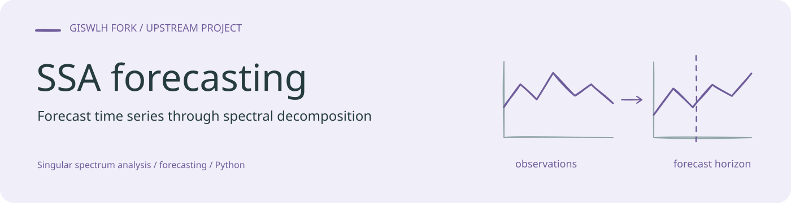
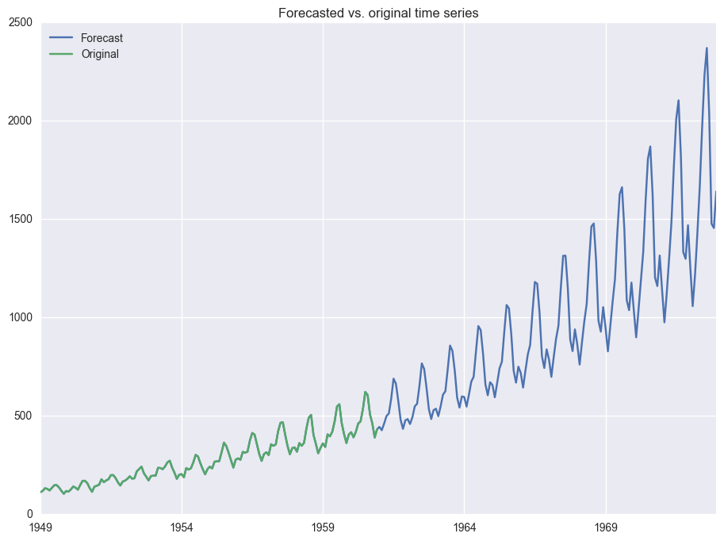

<!-- readme-visual-refresh:banner -->

<!-- /readme-visual-refresh:banner -->

# pySSA
Singular Spectrum Analysis for time series forecasting in Python

An example of the implementation of this code can be found in **[Singular Spectrum Analysis Example.ipynb](https://github.com/aj-cloete/pySSA/blob/master/Singular%20Spectrum%20Analysis%20Example.ipynb)**.

I will update the list of references/credits at another time. The research of *[Nina Golyandina](https://scholar.google.it/citations?user=1druVRYAAAAJ&hl=it)* from Russia was invaluable in aiding my understanding of this method.

[update 4 April 2017] - Please note that the current version requires a pandas dataframe with a **datetime** formatted index for it to work.  I will push an update soon to allow numpy array inputs.

Please feel free to fork the project and contribute!

<!-- readme-visual-refresh:artwork-source -->
[Editable banner artwork · Excalidraw](assets/readme/banner.excalidraw)
<!-- /readme-visual-refresh:artwork-source -->

<!-- readme-visual-refresh:selected-result -->

## 已有结果展示

原 SSA 示例保存的递归外推图，对照原始序列与后续预测；预测区间不等于已有观测验证。 该图为仓库已有上游示例，保留原有来源；本次仅整理展示，未重新运行。 [查看来源](https://github.com/GISWLH/SSA-forcast/blob/master/Singular%20Spectrum%20Analysis%20Example.ipynb)。

<!-- /readme-visual-refresh:selected-result -->
